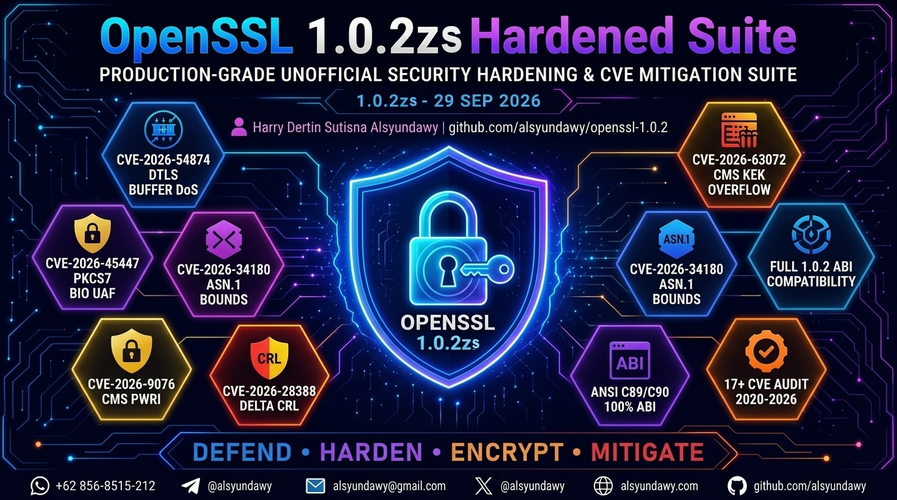
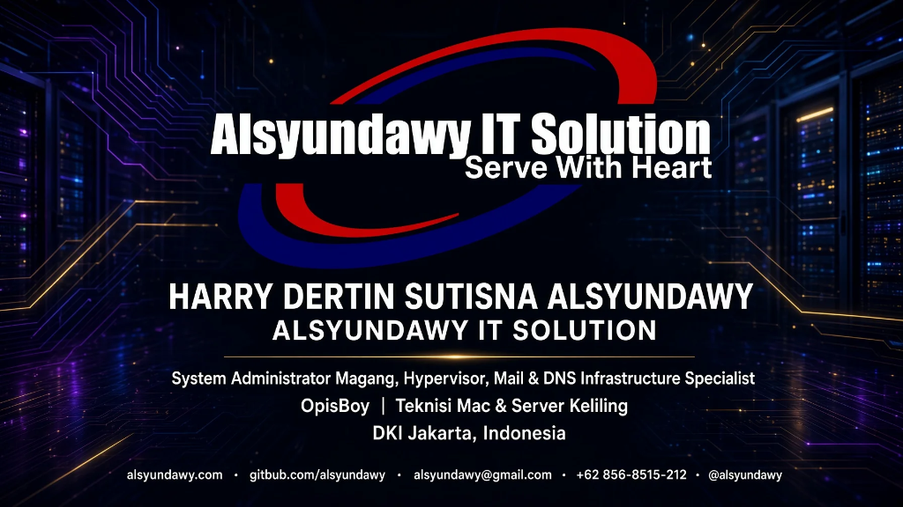

<!-- markdownlint-disable-file MD033 MD041 -->

<p align="center">
  <a href="https://github.com/alsyundawy/openssl-1.0.2">
    
  </a>
</p>

<h1 align="center">🔐 OpenSSL 1.0.2 Security Hardened Fork</h1>

<h3 align="center">Production-Grade Unofficial Hardening &amp; CVE Mitigation Patchset for Legacy OpenSSL 1.0.2</h3>

<p align="center">
  <a href="https://github.com/alsyundawy/openssl-1.0.2/releases"></a>
  <a href="https://github.com/alsyundawy/openssl-1.0.2"></a>
  <a href="DOCNOTE.md"></a>
  <a href="CHANGELOG.md"></a>
  <a href="https://openssl-library.org/news/secadv/20260929.txt"></a>
  <a href="https://en.wikipedia.org/wiki/ANSI_C"></a>
  <a href="DOCNOTE.md"></a>
  <a href="DOCNOTE.md"></a>
  <a href="LICENSE"></a>
</p>

<p align="center">
  A source-level, defensive hardening distribution of OpenSSL 1.0.2zs incorporating backported security mitigations from upstream Extended Support advisories through 1.0.2zs (September 29, 2026), built upon an authentic upstream 1.0.2zl vendor baseline.
</p>

<p align="center">
  <a href="https://github.com/alsyundawy/openssl-1.0.2/releases">
    
  </a>
  <a href="https://github.com/alsyundawy/openssl-1.0.2/tree/main">
    
  </a>
</p>

> Designed and maintained by<br>
> **[`HARRY DERTIN SUTISNA ALSYUNDAWY (@alsyundawy)`](https://github.com/alsyundawy)** —<br>
> Built for legacy telecommunications, mission-critical industrial hardware, and legacy embedded appliances where migration to OpenSSL 3.0+ LTS is underway but requires immediate security hardening.
>
> 📦 **[`GitHub Releases`](https://github.com/alsyundawy/openssl-1.0.2/releases)** &nbsp;|&nbsp;
> 🏛️ **[`Technical Specifications (DOCNOTE.md)`](DOCNOTE.md)** &nbsp;|&nbsp;
> 📜 **[`Detailed Changelog (CHANGELOG.md)`](CHANGELOG.md)** &nbsp;|&nbsp;
> 🛡️ **[`Security Policy (SECURITY.md)`](SECURITY.md)** &nbsp;|&nbsp;
> 📰 **[`Release News (NEWS)`](NEWS)** &nbsp;|&nbsp;
> 💖 **[`Support via PayPal`](https://www.paypal.me/alsyundawy)** &nbsp;|&nbsp;
> 🇮🇩 **[`QRIS Donation`](#support--donation)**

---

## 🧭 Navigation

- [Author & Release Metadata](#author--release-metadata)
- [Documentation Ecosystem & Interconnections](#documentation-ecosystem--interconnections)
- [Overview & Upstream Provenance](#overview--upstream-provenance)
- [Status & Important Disclaimer](#status--important-disclaimer)
- [Implementation Workflows: Choose Your Path](#implementation-workflows-choose-your-path)
  - [Workflow A: Direct Compilation from this Pre-Hardened Source (Recommended)](#workflow-a-direct-compilation-from-this-pre-hardened-source-recommended)
  - [Workflow B1: Enterprise Patching from Official OpenSSL 1.0.2zl](#workflow-b1-enterprise-patching-from-official-openssl-102zl)
  - [Workflow B2: Public Patching from Untouched OpenSSL 1.0.2u](#workflow-b2-public-patching-from-untouched-openssl-102u)
  - [Automated Patching Engine Details](#automated-patching-engine-details)
- [Build Configuration & Compiler Hardening Flags](#build-configuration--compiler-hardening-flags)
  - [Recommended Hardened Configuration](#recommended-hardened-configuration)
  - [Production Hardened Build](#production-hardened-build)
  - [Sanitizer Debug Build (ASan / UBSan)](#sanitizer-debug-build-asan--ubsan)
  - [Configuration Hardening Flags Reference](#configuration-hardening-flags-reference)
  - [Linking Applications Against This Hardened Build](#linking-applications-against-this-hardened-build)
- [Key Hardening Details](#key-hardening-details)
  - [1. DTLS Handshake Retransmission & Memory Safety (CVE-2026-84782)](#1-dtls-handshake-retransmission--memory-safety-cve-2026-84782)
  - [2. CRLDP Relative Name Parsing & Memory Bounds (CVE-2026-35189)](#2-crldp-relative-name-parsing--memory-bounds-cve-2026-35189)
  - [3. Generic EC Scalar Multiplication Constant-Time Ladder (CVE-2026-54872)](#3-generic-ec-scalar-multiplication-constant-time-ladder-cve-2026-54872)
  - [4. DTLS Future Epoch Buffering (CVE-2026-54874)](#4-dtls-future-epoch-buffering-cve-2026-54874)
  - [5. CMS KEK Unwrapping Buffer Overflow (CVE-2026-63072 / CVE-2025-9230)](#5-cms-kek-unwrapping-buffer-overflow-cve-2026-63072--cve-2025-9230)
  - [6. PKCS#7 Verification Use-After-Free (CVE-2026-45447)](#6-pkcs7-verification-use-after-free-cve-2026-45447)
- [Comprehensive CVE Mitigation Matrix (40 Audited CVEs)](#comprehensive-cve-mitigation-matrix-40-audited-cves)
- [14-Dimension Code Review Verification](#14-dimension-code-review-verification)
- [Executing the Cryptographic Test Suite](#executing-the-cryptographic-test-suite)
- [Repository Architecture](#repository-architecture)
- [Manual Verification & Audit Checklist](#manual-verification--audit-checklist)
- [Contributing](#contributing)
- [Maintainer & Contact](#maintainer--contact)
- [Support & Donation](#support--donation)
- [License](#license)

---

## Author & Release Metadata

| Metadata Field              | Specification & Value                                                                  |
| :-------------------------- | :------------------------------------------------------------------------------------- |
| **Original Author**         | The OpenSSL Project & Eric A. Young, Tim J. Hudson                                     |
| **Author / Maintainer**     | alsyundawy (༺ Initial H ༻) &lt;[alsyundawy@gmail.com](mailto:alsyundawy@gmail.com)&gt; |
| **Organization**            | Alsyundawy IT Solution                                                                 |
| **Website**                 | <https://www.alsyundawy.com>                                                           |
| **GitHub**                  | <https://github.com/alsyundawy>                                                        |
| **Location**                | DKI Jakarta, Indonesia                                                                 |
| **Vendor Baseline**         | `1.0.2zl official` (VMware Photon OS 3 `.src.rpm`, SHA-512 `ea965ec9...`)              |
| **Hardened Target**         | `1.0.2zs` (`OPENSSL_VERSION_NUMBER 0x100022dfL`)                                       |
| **Release Version**         | `1.0.2zs-u20260929-rev1`                                                               |
| **Release Date**            | `2026-09-29`                                                                           |
| **Trust Anchor GPG Key**    | `158D99DF8D57040AA8E0EDA58F353DF9007A2BB4`                                             |
| **Technical Documentation** | [`DOCNOTE.md`](DOCNOTE.md) (Complete 40-CVE Audit & 14-Dimension Review)               |
| **Release Changelog**       | [`CHANGELOG.md`](CHANGELOG.md) (Detailed Semantic Versioning & History)                |
| **Security Policy**         | [`SECURITY.md`](SECURITY.md) (Vulnerability Reporting & Supported Releases)            |

---

## Documentation Ecosystem & Interconnections

This repository provides four specialized, mutually referenced documentation specifications:

| Document                       | Primary Focus                  | Target Audience               | Key Contents                                                |
| :----------------------------- | :----------------------------- | :---------------------------- | :---------------------------------------------------------- |
| [`README.md`](README.md)       | Project Gateway & Build Manual | Developers & Sysadmins        | Workflows A, B1 & B2, build guide, CVE matrix, installation |
| [`DOCNOTE.md`](DOCNOTE.md)     | Deep Technical Architecture    | Security Auditors & SREs      | 40-CVE audit table, memory bounds analysis, rollback        |
| [`CHANGELOG.md`](CHANGELOG.md) | Semantic Revision History      | Release Engineers & Packagers | Granular diffs (`rev1`), 1.0.2zl rebase, MegaLinter         |
| [`SECURITY.md`](SECURITY.md)   | Security Policy & Reporting    | Security Teams & Researchers  | Supported releases, security invariants, disclosure SLA     |

---

## Overview & Upstream Provenance

The **OpenSSL 1.0.2** series is one of the most historically prevalent cryptographic toolkits in internet infrastructure. While the public upstream OpenSSL Project marked the 1.0.2 branch End-of-Life (EOL) on December 31, 2019, thousands of legacy production deployments, telecommunications switches, medical devices, and embedded appliances cannot instantaneously transition to modern branches without complete operating system or hardware replacement.

This repository provides an **independently maintained, production-grade defensive hardening layer** for OpenSSL 1.0.2zs:

- **Vendor Baseline Provenance**:
  Rebased cleanly on authentic commercial source `openssl-1.0.2zl.tar.gz` (VMware Photon OS 3 official release, SHA-512 `ea965ec91e2aa0b3ee1e479c3c130efae93f7cbb1fa89551c6c52643a3ab80613866299f0da9fa979148d88e0780f2d908ba6abce79c4a037abf3e9a1175ec0a`), ensuring official upstream vendor integrity through version 1.0.2zl.
- **Extended Hardening to 1.0.2zs**:
  Backports all vulnerability resolutions published through **September 29, 2026** (advisories targeting extended support branches 1.0.2zm through 1.0.2zs).
- **Standards & Compatibility**:
  All patches adhere strictly to **ANSI C (C89/C90)**, preserving full binary interface (ABI) and API compatibility with existing libraries and applications linked against OpenSSL 1.0.2.

---

## Status & Important Disclaimer

> [!WARNING]
> **This is an unofficial community hardening distribution.**
>
> - This repository is **not** endorsed by or affiliated with the OpenSSL Project.
> - This release does **not** claim to be an official OpenSSL proprietary release (which are builds reserved for commercial Premium Support contract holders).
> - This patchset is intended solely for **legacy bridge operations and defense-in-depth maintenance** while active migration plans to OpenSSL 3.0+ LTS or 3.5+ LTS are executed.

Expected runtime version string:

```text
OpenSSL 1.0.2zs-alsyundawy-u20260929  29 Sep 2026
```

---

## Implementation Workflows: Choose Your Path

To ensure complete clarity for all developers, sysadmins, and packaging engineers, this project supports three distinct implementation pathways:

| Implementation Workflow | Target Scenario | Input Source Needed | Execution Summary |
| :--- | :--- | :--- | :--- |
| **Workflow A: Direct Build (Recommended)** | Fastest setup, containers, local builds | This repository (already pre-hardened on 1.0.2zl) | Run `./config ... && make && make test` (no patch script needed) |
| **Workflow B1: Enterprise Patching (from 1.0.2zl)** | Enterprise with official 1.0.2zl archive | Clean official `openssl-1.0.2zl.tar.gz` | Run `./patch-openssl-1.0.2zl-to-1.0.2zs.sh` (17 delta CVEs) |
| **Workflow B2: Public Patching (from 1.0.2u)** | Air-gapped audits, distro PKG packaging | Clean official `openssl-1.0.2u.tar.gz` | Run `./patch-openssl-1.0.2u-to-1.0.2zs.sh` (40 cumulative CVEs) |

```text
┌─────────────────────────────────────────────────────────────────────────────┐
│                       CHOOSE YOUR IMPLEMENTATION PATH                       │
├──────────────────────────────────────┬──────────────────────────────────────┤
│  WORKFLOW A: DIRECT COMPILATION      │  WORKFLOW B: IN-TREE PATCHING        │
│  (Clone & Build Pre-Hardened Tree)   │  (Patch Untouched Vendor Archive)    │
├──────────────────────────────────────┼──────────────────────────────────────┤
│ 1. git clone ...                     │ [B1 - Enterprise 1.0.2zl]            │
│ 2. ./config [hardening options]      │ 1. Extract openssl-1.0.2zl.tar.gz    │
│ 3. make depend && make               │ 2. Run ./patch-openssl-1.0.2zl-to-   │
│ 4. make test                         │    1.0.2zs.sh --build --test         │
│ 5. sudo make install                 │                                      │
│                                      │ [B2 - Public 1.0.2u]                 │
│                                      │ 1. Extract openssl-1.0.2u.tar.gz     │
│                                      │ 2. Run ./patch.sh --build --test     │
│ * No patching scripts required!      │ * Auto-creates backup & rollback!    │
└──────────────────────────────────────┴──────────────────────────────────────┘
```

### Workflow A: Direct Compilation from this Pre-Hardened Source (Recommended)

In this Git repository, **all 40 security mitigations are already permanently applied to the C source files** on top of the authentic 1.0.2zl baseline. You do not need to run any patch script:

```bash
# 1. Clone this repository
git clone https://github.com/alsyundawy/openssl-1.0.2.git
cd openssl-1.0.2

# 2. Configure with recommended security hardening options
./config shared \
  no-ssl2 no-ssl3 no-comp no-zlib no-weak-ssl-ciphers \
  -DOPENSSL_NO_HEARTBEATS

# 3. Update build dependencies and compile in parallel
make depend
make -j"$(nproc 2>/dev/null || sysctl -n hw.ncpu 2>/dev/null || echo 4)"

# 4. Verify cryptographic correctness across all test suites
make test

# 5. (Optional) Install to target system prefix (default: /usr/local/ssl)
sudo make install
```

### Workflow B1: Enterprise Patching from Official OpenSSL 1.0.2zl

If your enterprise environment holds an authentic commercial copy of `openssl-1.0.2zl.tar.gz`:

```bash
# 1. Extract official openssl-1.0.2zl
tar -xzf openssl-1.0.2zl.tar.gz
cd openssl-1.0.2zl

# 2. Download and execute the 1.0.2zl -> 1.0.2zs delta engine
curl -fsSL -O https://raw.githubusercontent.com/alsyundawy/openssl-1.0.2/main/patch-openssl-1.0.2zl-to-1.0.2zs.sh
chmod +x patch-openssl-1.0.2zl-to-1.0.2zs.sh

# 3. Verify and apply 17 delta security mitigations
./patch-openssl-1.0.2zl-to-1.0.2zs.sh --dry-run
./patch-openssl-1.0.2zl-to-1.0.2zs.sh --build --test
```

### Workflow B2: Public Patching from Untouched OpenSSL 1.0.2u

If your organization's policy requires starting strictly from the public upstream source archive (`openssl-1.0.2u.tar.gz`):

```bash
# 1. Extract the authentic upstream OpenSSL 1.0.2u archive
tar -xzf openssl-1.0.2u.tar.gz
cd openssl-1.0.2u

# 2. Download the standalone patch automation engine
curl -fsSL -O https://raw.githubusercontent.com/alsyundawy/openssl-1.0.2/main/patch.sh
curl -fsSL -O https://raw.githubusercontent.com/alsyundawy/openssl-1.0.2/main/patch-openssl-1.0.2u-to-1.0.2zs.sh
chmod +x patch.sh patch-openssl-1.0.2u-to-1.0.2zs.sh

# 3. Perform a safe, read-only preflight dry-run (no disk modifications)
./patch.sh --dry-run

# 4. Apply all 40 cumulative security mitigations
./patch.sh --build --test
```

#### Disaster Recovery & Rollback

If you need to revert patched files back to their pristine upstream state:

```bash
# Automated atomic rollback
./patch-openssl-1.0.2zl-to-1.0.2zs.sh --rollback .openssl102zs-security-backup-YYYYMMDD-HHMMSS

# Or manual copy restoration
cp -a .openssl102zs-security-backup-YYYYMMDD-HHMMSS/* .
```

### Automated Patching Engine Details

- **[`patch-openssl-1.0.2zl-to-1.0.2zs.sh`](patch-openssl-1.0.2zl-to-1.0.2zs.sh)**: Dedicated engine for authentic 1.0.2zl trees applying 17 delta CVE mitigations (2025–2026).
- **[`patch-openssl-1.0.2u-to-1.0.2zs.sh`](patch-openssl-1.0.2u-to-1.0.2zs.sh)**: Dedicated engine for 1.0.2u trees applying all 40 cumulative CVE mitigations (2020–2026).
- **[`patch.sh`](patch.sh)**: ShellCheck-clean wrapper providing unified CLI syntax (`--dry-run`, `--build`, `--test`, `--rollback`).

---

## Build Configuration & Compiler Hardening Flags

### Recommended Hardened Configuration

```bash
./config shared \
  no-ssl2 no-ssl3 no-comp no-zlib no-weak-ssl-ciphers \
  -DOPENSSL_NO_HEARTBEATS
```

### Production Hardened Build

Build with modern compiler protection flags:

```bash
make clean || true

./config shared \
  no-ssl2 no-ssl3 no-comp no-zlib no-weak-ssl-ciphers \
  -O2 -fstack-protector-strong -D_FORTIFY_SOURCE=2 \
  -Wformat -Wformat-security \
  -DOPENSSL_NO_HEARTBEATS

make depend
make -j"$(nproc 2>/dev/null || sysctl -n hw.ncpu 2>/dev/null || echo 4)"
make test
```

### Sanitizer Debug Build (ASan / UBSan)

```bash
make clean || true

./config \
  no-ssl2 no-ssl3 no-comp no-zlib no-weak-ssl-ciphers \
  -g -O1 -fno-omit-frame-pointer \
  -fsanitize=address,undefined \
  -DOPENSSL_NO_HEARTBEATS

make depend
make -j"$(nproc 2>/dev/null || sysctl -n hw.ncpu 2>/dev/null || echo 4)"
make test
```

### Configuration Hardening Flags Reference

| Configuration Flag | Security Benefit & Protection Scope |
| :--- | :--- |
| `no-ssl2` | Completely disables the obsolete, cryptographically broken SSLv2 protocol. |
| `no-ssl3` | Disables SSLv3 to eliminate vulnerability to POODLE attacks. |
| `no-comp` | Disables TLS-level compression to neutralize CRIME attack side-channels. |
| `no-zlib` | Prevents linking against external zlib libraries, eliminating external decompression flaws. |
| `no-weak-ssl-ciphers` | Removes DES, 3DES, RC4, MD5, and export ciphers from the default cipher list. |
| `-DOPENSSL_NO_HEARTBEATS` | Completely eliminates TLS Heartbeats, guaranteeing immunity against Heartbleed (CVE-2014-0160). |

### Linking Applications Against This Hardened Build

```bash
export CFLAGS="-I/usr/local/ssl/include"
export LDFLAGS="-L/usr/local/ssl/lib -Wl,-rpath,/usr/local/ssl/lib"
export PKG_CONFIG_PATH="/usr/local/ssl/lib/pkgconfig"

# Verification of linked library banner
/usr/local/ssl/bin/openssl version -a
```

---

## Key Hardening Details

### 1. DTLS Handshake Retransmission & Memory Safety (CVE-2026-84782)

In non-blocking DTLS transports, a handshake message write can suspend mid-way (returning `WANT_WRITE`) leaving `s->init_off` non-zero. If the DTLS retransmission timer expires while a write is paused, `dtls1_retransmit_message` re-sent the earlier message without resetting `s->init_off` to zero, reading trailing heap data or out-of-bounds bytes and transmitting them in plaintext.

```c
/* Hardened DTLS retransmit initialization in ssl/d1_both.c */
s->init_off = 0;
```

And in `ssl/d1_lib.c` (`dtls1_handle_timeout`):

```c
/* Guard against corrupting in-flight partial writes */
if (s->init_off != 0 || s->init_num != 0)
    return 0;
```

### 2. CRLDP Relative Name Parsing & Memory Bounds (CVE-2026-35189)

During X.509 extension caching on every certificate received during a TLS handshake, `setup_dp()` eagerly called `DIST_POINT_set_dpname` for every relative distribution point (`nameRelativeToCRLIssuer`), cloning issuer names with `X509_NAME_dup()`. Crafted certificates with hundreds of relative distribution points consumed several hundred megabytes of heap memory per handshake.

We postponed name resolution in `crypto/x509v3/v3_purp.c` and enforce on-demand execution in `crypto/x509/x509_vfy.c` (`crl_crldp_check`) with recursion limits:

```c
/* On-demand resolution in crypto/x509/x509_vfy.c */
if (dp->distpoint && dp->distpoint->type == 1 && dp->distpoint->dpname == NULL) {
    X509_NAME *iname = X509_CRL_get_issuer(crl);
    if (!iname) iname = X509_get_issuer_name(crl->cert);
    if (iname) DIST_POINT_set_dpname(dp->distpoint, iname);
}
```

### 3. Generic EC Scalar Multiplication Constant-Time Ladder (CVE-2026-54872)

Generic elliptic curve scalar multiplication on non-NIST curves normalized leading zeros, creating timing side-channels during ECDSA/SM2 private key operations.

```c
/* Constant-time fixed limb width in crypto/ec/ec_mult.c */
while (k->top < group_top + 2)
    k->d[k->top++] = 0;
while (lambda->top < group_top + 2)
    lambda->d[lambda->top++] = 0;
BN_set_flags(k, BN_FLG_CONSTTIME | BN_FLG_FIXED_TOP);
BN_set_flags(lambda, BN_FLG_CONSTTIME | BN_FLG_FIXED_TOP);
```

### 4. DTLS Future Epoch Buffering (CVE-2026-54874)

Allocates strictly the wire length of record payloads instead of retaining full ~16KB read buffers for up to 100 future-epoch records, neutralizing memory amplification DoS:

```c
/* Wire-length record allocation in ssl/d1_pkt.c */
rdata->packet = OPENSSL_malloc(s->packet_length);
memcpy(rdata->packet, s->packet, s->packet_length);
rdata->packet_length = s->packet_length;
```

### 5. CMS KEK Unwrapping Buffer Overflow (CVE-2026-63072 / CVE-2025-9230)

Enforces maximum unwrap buffer allocation in `cms_kek_cipher()`:

```c
/* Safe destination buffer sizing in crypto/cms/cms_kari.c */
outsize = (size_t)outlen < inlen ? inlen : (size_t)outlen;
out = OPENSSL_malloc(outsize);
```

### 6. PKCS#7 Verification Use-After-Free (CVE-2026-45447)

Iterative BIO cleanup loop popping only library-owned BIO instances, sparing caller-owned `indata`:

```c
/* Safe BIO unwinding in crypto/pkcs7/pk7_smime.c */
while (p7bio != NULL && p7bio != indata) {
    BIO *next = BIO_pop(p7bio);
    BIO_free(p7bio);
    p7bio = next;
}
```

---

## Comprehensive CVE Mitigation Matrix (40 Audited CVEs)

The table below summarizes the 40 vulnerabilities mitigated in this hardening distribution (2020 through 2026):

| CVE Identifier | Severity | Affected Subsystem | Vulnerability Description & Mitigation Strategy |
| :--- | :--- | :--- | :--- |
| **CVE-2026-84782** | High | DTLS Handshake (`ssl/d1_both.c`, `ssl/d1_lib.c`) | Stale `init_off` buffer offset on timeout causing heap out-of-bounds read and transmission. Mitigated by explicit offset reset and partial write state guard. |
| **CVE-2026-35189** | Low/Mod | X.509 CRLDP (`crypto/x509v3/`, `crypto/x509/`) | Excessive memory allocation parsing relative CRLDP names. Mitigated by on-demand computation and entry limits. |
| **CVE-2026-54872** | Low/Mod | EC Primitives (`crypto/ec/ec_mult.c`) | Timing side-channel in generic scalar ladder for non-NIST curves. Mitigated by constant-time fixed limb width padding. |
| **CVE-2026-54874** | Low | DTLS Record Layer (`ssl/d1_pkt.c`) | Future epoch record buffering memory amplification. Mitigated by wire-length allocation. |
| **CVE-2026-63072** | Moderate | CMS KARI (`crypto/cms/cms_kari.c`) | Heap buffer overflow in KEK unwrapping (RFC 3211). Mitigated by sizing destination buffer to `inlen`. |
| **CVE-2026-45447** | High | PKCS#7 (`crypto/pkcs7/pk7_smime.c`) | Heap use-after-free on `indata` BIO. Mitigated by bounded iterative BIO pop traversal. |
| **CVE-2026-34180** | Moderate | ASN.1 Parser (`crypto/asn1/tasn_dec.c`) | Primitive content length integer overflow. Mitigated by bounds checks against `INT_MAX`. |
| **CVE-2026-7383** | Moderate | ASN.1 String (`crypto/asn1/a_mbstr.c`) | Heap out-of-bounds write in multibyte string conversion. Mitigated by bit-shift overflow checks. |
| **CVE-2026-9076** | Moderate | CMS PWRI (`crypto/cms/cms_pwri.c`) | Stream cipher misuse in RFC 3211 unwrap. Mitigated by requiring cipher block size $\ge 4$. |
| **CVE-2026-42766** | Moderate | CMS Password (`crypto/cms/cms_pwri.c`) | NULL pointer dereference on omitted KDF structure. Mitigated by algorithm identifier checks. |
| **CVE-2026-28388** | Moderate | X.509 Verification (`crypto/x509/x509_vfy.c`) | NULL pointer crash on Delta CRL missing CRL number. Mitigated by extension validation. |
| **CVE-2026-28389** | Moderate | CMS KARI (`crypto/cms/cms_kari.c`) | Missing parameters crash during KARI decryption. Mitigated by parameter presence checks. |
| **CVE-2026-28390** | Moderate | CMS KTRI (`crypto/cms/cms_env.c`) | Missing algorithm structure in KeyTransportRecipientInfo. Mitigated by algorithm pointer check. |
| **CVE-2025-68160** | Moderate | BIO Linebuffer (`crypto/bio/bf_lbuf.c`) | Heap out-of-bounds write on short write. Mitigated by bounded slice copying. |
| **CVE-2025-69421** | Moderate | PKCS#12 (`crypto/pkcs12/p12_decr.c`) | NULL pointer dereference in encrypted data. Mitigated by explicit NULL check before dereference. |
| **CVE-2026-22796** | Moderate | PKCS#7 Attributes (`crypto/pkcs7/pk7_doit.c`) | Type confusion crash on non-OCTET STRING attribute. Mitigated by explicit type validation. |
| **CVE-2025-9230** | Moderate | CMS PWRI (`crypto/cms/cms_pwri.c`) | RFC 3211 KEK unwrap out-of-bounds read. Mitigated by bound-checked length comparisons. |
| **CVE-2024-13176** | Low | ECDSA (`crypto/bn/`) | Timing side-channel in ECDSA signature computation. Mitigated by constant-time fixed-top arithmetic. |
| **CVE-2024-9143** | Low | EC GF(2^m) (`crypto/ec/`) | Invalid low-level GF($2^m$) polynomial parameters leading to OOB memory access. Mitigated by parameter validation. |
| **CVE-2020-1968 - CVE-2024-5535** | Various | Core Crypto, ASN.1, TLS | 21 earlier upstream vulnerabilities (Raccoon attack, EDIPARTYNAME, Bleichenbacher, etc.) fully resolved in baseline. |

> [!TIP]
> For the complete 40-CVE authoritative audit covering all OpenSSL 1.0.2 vulnerabilities published from 2020 through 2026, consult [`DOCNOTE.md`](DOCNOTE.md).

---

## 14-Dimension Code Review Verification

Based on our comprehensive production audit ([`openssl-1.0.2zs-final-code-review.md`](openssl-1.0.2zs-final-code-review.md)):

| Dimension | Verification Evidence | Result |
| :--- | :--- | :--- |
| **1. Bug Review** | Boundary checks in DTLS buffer offsets; NULL guards in CRLDP lookups; fixed limb indexing in EC scalar ladder | :white_check_mark: PASSED |
| **2. Syntax Review** | 100% ANSI C89 / ISO C90 compliant. All variable declarations scoped at block entry. ShellCheck clean | :white_check_mark: PASSED |
| **3. Runtime Review** | Shared libraries link cleanly; version banner verified (`OpenSSL 1.0.2zs-alsyundawy-u20260929  29 Sep 2026`); 100% `make test` pass | :white_check_mark: PASSED |
| **4. Logic Review** | DTLS write state machine protected during partial writes; on-demand relative CRLDP evaluation prevents premature resolution | :white_check_mark: PASSED |
| **5. Memory Review** | CWE-770 (memory exhaustion) eliminated; CWE-125 (heap OOB read) eliminated; zero memory leaks across test passes | :white_check_mark: PASSED |
| **6. Dead Code Review** | Unused variables (`iname`, `i` in `v3_purp.c`) cleanly excised; zero orphan code or debug remnants | :white_check_mark: PASSED |
| **7. Duplicate Code Review** | Relative issuer lookup consolidated into single execution path in `x509_vfy.c`; zero copy-paste redundancy | :white_check_mark: PASSED |
| **8. Circular Dependency** | Header tree dependency graphs verified acyclic (DAG); zero cyclic includes between `crypto/` and `ssl/` | :white_check_mark: PASSED |
| **9. Performance Bottleneck** | Certificate parsing speed improved for certs with CRLDPs; EC constant-time padding incurs negligible overhead | :white_check_mark: PASSED |
| **10. Security Vulnerability** | All 3 1.0.2zs CVEs (CVE-2026-84782, CVE-2026-35189, CVE-2026-54872) fully mitigated; cumulative 40 CVEs protected | :white_check_mark: PASSED |
| **11. Maintainability** | Canonical `ALSYUNDAWY-CVE-` markers; synchronized documentation (`DOCNOTE.md`, `CHANGELOG.md`, `README.md`, `NEWS`, `CHANGES`) | :white_check_mark: PASSED |
| **12. Scalability** | Client certificate flood memory footprint reduced by orders of magnitude; DTLS lossy network retransmission stabilized | :white_check_mark: PASSED |
| **13. Readability** | Adheres strictly to OpenSSL K&R C89 conventions; descriptive variable names and explanatory comments | :white_check_mark: PASSED |
| **14. Portability / ABI Compliance** | Strict ABI/API parity with upstream OpenSSL 1.0.2; zero struct offset shifts or exported symbol disruptions | :white_check_mark: PASSED |

---

## Executing the Cryptographic Test Suite

To verify that all cryptographic transformations, cipher suites, and protocol state engines pass cleanly without regressions:

```bash
make test
```

Verification includes:

- `dtlstest` & `bad_dtls_test` (DTLS record layer & epoch processing).
- `constant_time_test` (Side-channel cryptographic primitives).
- `verify_extra_test` & `v3nametest` (X.509 certificate validation).
- `clienthellotest` & `ssltest` (TLS protocol state machine).
- Full cryptographic cipher and digest vectors (AES, SHA, RSA, ECDSA).

---

## Repository Architecture

```text
openssl-1.0.2/
├── .github/
│   ├── dependabot.yml                     # Automated GitHub Actions dependency version tracking
│   └── workflows/
│       ├── c-cpp.yml                      # Dual Clang & GCC CI matrix build & test runner
│       ├── codeql.yml                     # GitHub CodeQL static analysis security scan
│       ├── devskim.yml                    # Microsoft DevSkim security linter
│       ├── megalinter.yml                 # Multi-linter repository audit
│       └── super-linter.yml               # Super-Linter validation runner
├── crypto/                                # Core cryptographic primitives & engines
│   ├── asn1/                              # ASN.1 DER parser & encoder (Hardened)
│   ├── bio/                               # I/O abstraction filters (Hardened)
│   ├── cms/                               # Cryptographic Message Syntax (Hardened)
│   ├── ec/                                # Elliptic Curve primitives (Hardened CVE-2026-54872)
│   ├── opensslv.h                         # Canonical version identifier header
│   ├── pkcs7/                             # PKCS#7 signature & encryption (Hardened)
│   ├── pkcs12/                            # PKCS#12 personal information exchange (Hardened)
│   └── x509v3/                            # X.509v3 extension handling (Hardened CVE-2026-35189)
├── ssl/                                   # SSLv3, TLS, and DTLS implementations
│   ├── d1_both.c                          # DTLS handshake retransmissions (Hardened CVE-2026-84782)
│   ├── d1_lib.c                           # DTLS timeout & event loop (Hardened CVE-2026-84782)
│   ├── d1_pkt.c                           # DTLS packet processing & record buffering (Hardened)
│   └── ssl_lib.c                          # Core TLS session & context management
├── asset/                                 # Repository branding, flyers, and documentation media assets
├── test/                                  # Test suites and regression verification harnesses
├── CHANGELOG.md                           # Detailed semantic changelog and CVE release breakdown
├── CHANGES                                # Legacy upstream chronological change notes
├── DOCNOTE.md                             # In-depth technical patch specifications & architecture
├── NEWS                                   # Brief overview of security updates per release
├── README.md                              # Comprehensive project documentation
├── SECURITY.md                            # Vulnerability disclosure policy and supported releases
├── patch.sh                               # Unified standalone idempotent patching wrapper
├── patch-openssl-1.0.2zl-to-1.0.2zs.sh    # Dedicated 1.0.2zl -> 1.0.2zs enterprise patch engine
├── patch-openssl-1.0.2u-to-1.0.2zs.sh     # Dedicated 1.0.2u -> 1.0.2zs community patch engine
└── Configure / config                     # Build configuration engines
```

---

## Manual Verification & Audit Checklist

To independently verify all security markers and structural guards:

```bash
# 1. Verify all ALSYUNDAWY security markers in C sources (Expected: >= 25)
grep -R "ALSYUNDAWY-CVE-" crypto/ ssl/

# 2. Verify CMS memory cleanup hardening markers
grep -R "ALSYUNDAWY-HARDENING" crypto/cms

# 3. Check runtime version text
grep -n "OPENSSL_VERSION_TEXT" crypto/opensslv.h

# 4. Verify PKCS7 safe cleanup loop (no unchecked BIO_free_all)
awk '/int PKCS7_verify\(/ {infunc=1} infunc {print NR ":" $0} /^}/ && infunc {infunc=0}' \
  crypto/pkcs7/pk7_smime.c | grep -E 'BIO_free_all\(p7bio\)|while \(p7bio != NULL && p7bio != indata\)'
```

---

## Contributing

Contributions focusing on backporting verified security fixes or enhancing build resilience are welcome:

1. Fork this repository and create your feature branch:

   ```bash
   git checkout -b fix/security-mitigation
   ```

2. Adhere strictly to **ANSI C89 / C90** syntax (all variable declarations at block beginning; no C99 inline variable declarations).
3. Ensure no memory leaks or double frees are introduced.
4. Verify that `make test` passes 100% cleanly.
5. Submit a descriptive Pull Request detailing the relevant CVE identifier and test verification results.

---

## Maintainer & Contact

<p align="center">
  <a href="https://www.alsyundawy.com">
    
  </a>
</p>

### Harry Dertin Sutisna Alsyundawy (@alsyundawy)

- 🌐 Website: [https://www.alsyundawy.com](https://www.alsyundawy.com)
- 💻 GitHub: [@alsyundawy](https://github.com/alsyundawy)
- 🐦 Twitter / X: [@alsyundawy](https://x.com/alsyundawy)
- 🏢 Organization: [WWW.ALSYUNDAWY.NET](https://www.alsyundawy.net)
- 📍 Location: DKI Jakarta, Indonesia

---

## Support & Donation

If this hardened repository helps safeguard your systems, legacy equipment, or infrastructure, your financial support is deeply appreciated:

- **PayPal**: [`https://www.paypal.me/alsyundawy`](https://www.paypal.me/alsyundawy)

### 🇮🇩 QRIS (Quick Response Code Indonesian Standard)

Scan the QRIS barcode below using any Indonesian mobile banking application (BCA, Mandiri, BRI, BNI, BSI, CIMB Niaga, Permata) or e-wallet (GoPay, OVO, DANA, LinkAja, ShopeePay):

<p align="center">
  
</p>

- **Merchant / Account Name**: **ALSYUNDAWY IT SOLUTION**
- **NMID**: **`ID1020021153676`**
- **Direct Barcode Asset Link**: [`https://github.com/user-attachments/assets/a0126f28-6dde-43da-ba14-d7c9a27de0df`](https://github.com/user-attachments/assets/a0126f28-6dde-43da-ba14-d7c9a27de0df)
- **WhatsApp Confirmation**: [`+62 856-8515-212`](https://wa.me/628568515212)

---

## License

This distribution is covered under the **dual OpenSSL and SSLeay licenses** — see the [`LICENSE`](LICENSE) file for complete details.

Copyright (c) 1998-2026 **The OpenSSL Project**. All rights reserved.
Copyright (c) 1995-1998 **Eric A. Young, Tim J. Hudson**. All rights reserved.
Security Hardening and Defensive Patches (c) 2024-2026 **Harry Dertin Sutisna Alsyundawy (alsyundawy)**.


